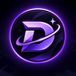

<div align="center">



# DimensiUI

**Library UI Roblox yang modular dengan tema Midnight, lengkap dengan build satu file.**

[](CHANGELOG.md)
[](LICENSE)
[](https://create.roblox.com/docs)
[](dist/main.lua)

[English](README.md) · Bahasa Indonesia

</div>

| Metadata rilis | Nilai |
|---|---|
| Proyek | DimensiUI |
| Versi | `1.0.1` |
| Tipe rilis | Stabil |
| Author | telatnakal |
| Tampilan | Midnight (permukaan navy, aksen violet) |
| Runtime | Roblox Luau |

**Version:** 1.0.1

---

## Daftar isi

- [Keunggulan](#keunggulan)
- [Mulai cepat](#mulai-cepat)
- [Opsi window](#opsi-window)
- [Komponen](#komponen)
- [Bubble minimize](#bubble-minimize)
- [Notifikasi dan dialog](#notifikasi-dan-dialog)
- [Addon](#addon)
- [Beberapa instance library](#beberapa-instance-library)
- [Tema dan tipografi](#tema-dan-tipografi)
- [Struktur proyek](#struktur-proyek)
- [Pengembangan](#pengembangan)
- [Lisensi dan provenance](#lisensi-dan-provenance)

## Keunggulan

- **Kontrol lengkap:** window, tab, section, button, toggle, slider, dropdown, input, keybind, color picker, dan paragraph.
- **Notifikasi dan dialog**, termasuk tombol aksi pada notifikasi.
- **Sistem visual Midnight:** permukaan navy dengan aksen violet yang selektif, plus kustomisasi aksen saat runtime.
- **Layout responsif:** ukuran window mengikuti viewport, sidebar bisa dilipat, dan perataan kontrol adaptif.
- **Bubble minimize:** window mengecil menjadi logo DimensiUI bulat yang menempel di tepi paling kiri, pada 25% tinggi layar dari atas, dan membuka kembali window saat diklik.
- **Lifecycle bersih:** instance library terpisah (`NewInstance()`), callback pembersihan per instance (`AddCleanup()`), dan package motion internal (`DimensiMotion`).
- **Addon:** `SaveManager` dan `InterfaceManager`, keduanya dengan factory per instance.
- **Dua cara distribusi:** source modular (`src/`) dan bundle satu file hasil build (`dist/main.lua`).

## Mulai cepat

Muat bundle standalone di lingkungan yang mengizinkan `loadstring` dan permintaan HTTP:

```lua
local DimensiUI = loadstring(game:HttpGet(
    "https://raw.githubusercontent.com/telatnakal/DimensiUI/main/dist/main.lua"
))()

local Window = DimensiUI:CreateWindow({
    Title = "DimensiUI",
    SubTitle = "v" .. DimensiUI.Version,
    TabWidth = 160,
    Size = UDim2.fromOffset(580, 420),
    Theme = "Dimensi", -- preset Midnight (key "Dimensi" dipertahankan demi kompatibilitas)
})

local Tab = Window:AddTab({ Title = "Main", Icon = "home", Description = "Ringkasan dan aksi cepat" })
local Section = Tab:AddSection("Controls")

Section:AddButton({
    Title = "Contoh",
    Description = "Menjalankan callback",
    Callback = function()
        print("Diklik")
    end,
})

local Toggle = Section:AddToggle("AutoFeature", { Title = "Auto feature", Default = false })
Toggle:OnChanged(function()
    print("AutoFeature:", DimensiUI.Options.AutoFeature.Value)
end)

Window:SelectTab(1)
```

Contoh lengkap yang siap dijalankan (tab, dialog, slider, dropdown, addon) ada di [`Example.lua`](Example.lua).

**Source modular:** gunakan `default.project.json` dengan Rojo, atau letakkan hierarki `src/` di Roblox Studio sebagai pohon ModuleScript lalu `require` modul root (`src/init.lua`).

## Opsi window

`DimensiUI:CreateWindow(config)` menerima:

| Opsi | Tipe | Default | Keterangan |
|---|---|---|---|
| `Title` | `string` | wajib | Judul window di header sidebar. |
| `SubTitle` | `string` | `""` | Teks sekunder di bawah judul. |
| `TabWidth` | `number` | `170` | Lebar sidebar, antara `100` dan `400`. |
| `Size` | `UDim2` | offset `590 × 470` | Ukuran awal, dibatasi oleh viewport. |
| `Theme` | `string` | `"Dimensi"` | Preset Midnight. Hanya `"Dimensi"` yang diterima. |
| `MinimizeKey` | `Enum.KeyCode` | `RightControl` | Menyembunyikan atau menampilkan seluruh interface. |
| `Icon` | `string \| number \| false` | logo bawaan | Gambar untuk [bubble minimize](#bubble-minimize). |

Method window yang berguna: `AddTab`, `SelectTab`, `Dialog`, `Minimize`, `SetCollapsed`, `ToggleHidden`, `ToggleSidebar`, `SetSidebarCollapsed`, `SetIcon`, `Destroy`. Tab menerima field opsional `Description` yang tampil di header halaman.

## Komponen

Tambahkan komponen ke tab atau section: `Tab:AddSection("Judul")` mengembalikan section dengan method `Add*` yang sama.

| Komponen | Method | Opsi utama | Method objek |
|---|---|---|---|
| Button | `AddButton(config)` | `Title`, `Description`, `Callback` | — |
| Toggle | `AddToggle(id, config)` | `Title`, `Description`, `Default`, `Callback` | `OnChanged`, `SetValue` |
| Slider | `AddSlider(id, config)` | `Title`, `Description`, `Default`, `Min`, `Max`, `Rounding`, `Callback` | `OnChanged`, `SetValue` |
| Dropdown | `AddDropdown(id, config)` | `Title`, `Description`, `Values`, `Default`, `Multi`, `AllowNull`, `Callback` | `OnChanged`, `SetValue`, `SetValues`, `Open`, `Close` |
| Input | `AddInput(id, config)` | `Title`, `Description`, `Default`, `Placeholder`, `Numeric`, `MaxLength`, `Finished`, `Callback` | `OnChanged`, `SetValue` |
| Keybind | `AddKeybind(id, config)` | `Title`, `Description`, `Default`, `Mode` (`Toggle`, `Hold`, `Always`), `Callback`, `ChangedCallback` | `OnClick`, `OnChanged`, `SetValue`, `GetState`, `DoClick` |
| Color picker | `AddColorpicker(id, config)` | `Title`, `Description`, `Default`, `Transparency`, `Callback` | `OnChanged`, `SetValue`, `SetValueRGB` |
| Paragraph | `AddParagraph(config)` | `Title`, `Content` | — |

Komponen yang dibuat dengan `id` tersimpan di `DimensiUI.Options[id]`, yaitu data yang disimpan oleh `SaveManager`.

## Bubble minimize

Tombol minimize di title bar mengecilkan window menjadi logo DimensiUI bulat yang kecil.

| Perilaku | Detail |
|---|---|
| Posisi | Menempel di **tepi paling kiri**, dengan pusatnya pada **25% tinggi layar** (dari atas). Setiap minimize mengembalikannya ke posisi ini, di resolusi apa pun. |
| Visibilitas | Selalu digambar di atas elemen interface lain (`ZIndex = 100`) dan tetap berada di dalam layar saat viewport berubah. |
| Buka kembali | Klik atau ketuk bubble untuk memunculkan window di posisi sebelumnya. |
| Pindah | Seret bubble untuk memindahkannya; bubble tetap berada di dalam layar. |
| Animasi | Masuk dengan geser dan efek pop yang halus, sedikit membesar saat di-hover, menekan saat diklik, lalu memudar ketika window dibuka kembali. |
| Tombol sembunyi | `RightControl` (bisa diubah lewat `MinimizeKey`, atau Hide Bind di InterfaceManager) menyembunyikan window *dan* bubble; tekan lagi untuk menampilkan apa pun yang sebelumnya terlihat. |

```lua
local Window = DimensiUI:CreateWindow({
    Title = "DimensiUI",
    MinimizeKey = Enum.KeyCode.RightControl,
    Icon = "rbxassetid://123456789", -- opsional
})

Window:Minimize()         -- toggle minimize
Window:SetCollapsed(true) -- minimize / buka kembali secara eksplisit
Window:ToggleHidden()     -- sama seperti menekan tombol sembunyi
print(Window.Minimized, Window.IconStatus)
```

`Icon` bersifat opsional:

- **Kosong:** logo DimensiUI bawaan, PNG kecil yang tertanam di library dan ditulis sekali ke folder workspace executor `DimensiUI/`. Membutuhkan `writefile` dan `getcustomasset`, dan tidak melakukan permintaan jaringan.
- **`false`:** huruf "D" polos.
- **Gambar sendiri:** asset id Roblox (`"rbxassetid://ID"` atau angka), path file di workspace executor, atau URL gambar. URL diunduh sekali ke `DimensiUI/` lalu dipakai ulang (satu-satunya permintaan jaringan yang bisa dilakukan library). Link halaman `github.com/.../blob/...` otomatis diubah ke link raw.

Jika ikon kustom gagal dimuat, notifikasi menjelaskan alasannya dan logo bawaan dipakai. Jika executor sama sekali tidak bisa memuat gambar, bubble memakai huruf "D" sehingga tidak pernah kosong. `Window.IconStatus` menjelaskan apa yang sedang ditampilkan bubble.

## Notifikasi dan dialog

```lua
DimensiUI:Notify({
    Title = "DimensiUI",
    Content = "Konfigurasi tersimpan.",
    SubContent = "autoload.json",
    Duration = 4,
    Buttons = {
        { Title = "Urungkan", Callback = function() print("Urungkan") end },
    },
})

Window:Dialog({
    Title = "Konfirmasi",
    Content = "Jalankan aksi ini?",
    Buttons = {
        { Title = "Ya", Callback = function() print("Dikonfirmasi") end },
        { Title = "Batal" },
    },
})
```

Callback dijalankan lewat `Library:SafeCallback`, sehingga error di callback Anda tampil sebagai notifikasi dan tidak merusak interface.

## Addon

`SaveManager` dan `InterfaceManager` mempertahankan export singleton lama dan juga menyediakan factory instance. Hubungkan tiap instance addon dengan instance library yang sesuai:

```lua
local SaveManager = loadstring(game:HttpGet("URL_RAW_SAVEMANAGER"))()
local InterfaceManager = loadstring(game:HttpGet("URL_RAW_INTERFACEMANAGER"))()

SaveManager:SetLibrary(DimensiUI)
InterfaceManager:SetLibrary(DimensiUI)
SaveManager:IgnoreThemeSettings()
SaveManager:SetIgnoreIndexes({ "MenuKeybind" })
SaveManager:SetFolder("DimensiUISettings/GameSaya")
InterfaceManager:SetFolder("DimensiUISettings")

InterfaceManager:BuildInterfaceSection(Tabs.Settings)
SaveManager:BuildConfigSection(Tabs.Settings)
SaveManager:LoadAutoloadConfig()
```

Gunakan folder berbeda untuk tiap manager bila konfigurasi harus disimpan terpisah. Isolasi instance addon tidak otomatis membuat namespace filesystem yang terpisah.

## Beberapa instance library

Buat instance library terpisah bila membutuhkan lifecycle UI yang independen:

```lua
local PrimaryUI = DimensiUI
local SecondaryUI = DimensiUI:NewInstance() -- CreateInstance() adalah alias

PrimaryUI:CreateWindow({ Title = "Primary" })
SecondaryUI:CreateWindow({ Title = "Secondary" })

SecondaryUI:Destroy() -- PrimaryUI tetap hidup
```

Setiap instance dirancang untuk memiliki pohon modul dan cache, GUI, registry tema, state tab, notifikasi, resource motion, dan lifecycle pembersihannya sendiri. Daftarkan pekerjaan pembersihan tambahan dengan `AddCleanup`; callback dijalankan dalam urutan terbalik dari pendaftarannya saat instance dihancurkan:

```lua
DimensiUI:AddCleanup(function()
    -- Lepaskan resource milik instance library ini.
end)
```

Verifikasi perilaku runtime di lingkungan Roblox yang Anda tuju.

## Tema dan tipografi

Preset visualnya adalah **Midnight**, terdaftar secara internal sebagai `Dimensi` demi kompatibilitas. Memakai permukaan navy pekat dan aksen violet yang selektif, dengan permukaan solid dan transparansi window opsional (tanpa blur).

```lua
DimensiUI:SetAccent(Color3.fromRGB(255, 120, 90)) -- aksen saat runtime
DimensiUI:ResetAccent()
DimensiUI:ToggleTransparency(true)
```

Sidebar dilipat lewat kontrol menu di header atau `Window:ToggleSidebar()`. Resolver tipografi mencoba Builder Sans dan beralih ke keluarga font Roblox yang didukung; ketersediaan font bergantung pada runtime Roblox.

## Struktur proyek

```text
DimensiUI/
├── Addons/                  # SaveManager dan InterfaceManager
├── Assets/                  # Sumber logo (d-icon-128.png, d-icon-bubble.png)
├── dist/
│   └── main.lua             # Bundle standalone hasil build (jangan diedit manual)
├── scripts/
│   ├── audit_static.py      # Pemeriksaan statis: parity, versi, kontrak
│   ├── build_bundle.py      # src/ -> dist/main.lua
│   └── build_icon.py        # Assets/d-icon-bubble.png -> src/BubbleIcon.lua
├── src/                     # Source modular (sumber kebenaran)
│   ├── Components/          # Window, TitleBar, Tab, Section, Dialog, Notification, ...
│   ├── Elements/            # Button, Toggle, Slider, Dropdown, Input, Keybind, Colorpicker, Paragraph
│   ├── Packages/DimensiMotion/  # Package motion / spring internal
│   ├── Themes/              # Tema Midnight ("Dimensi")
│   ├── BubbleIcon.lua       # Logo tertanam (dihasilkan build_icon.py)
│   ├── Creator.lua          # Factory instance, registry tema, pelacakan signal
│   ├── Icons.lua            # Peta ikon
│   └── init.lua             # Entry point library (Version ada di sini)
├── CHANGELOG.md
├── Example.lua              # Contoh penggunaan
├── LICENSE                  # MIT
├── PROVENANCE.md
└── default.project.json     # Mapping Rojo
```

## Pengembangan

`src/` adalah sumber kebenaran. Setelah mengeditnya, bangun ulang bundle dan jalankan audit:

```bash
python3 scripts/build_bundle.py    # src/ -> dist/main.lua
python3 scripts/audit_static.py    # parity, konsistensi versi, kontrak bubble
```

Jika Anda mengganti logo, hasilkan ulang salinan tertanamnya lebih dulu:

```bash
python3 scripts/build_icon.py          # Assets/d-icon-bubble.png -> src/BubbleIcon.lua
python3 scripts/build_icon.py --check  # verifikasi keduanya cocok
```

Untuk merilis versi baru, perbarui `Version` di `src/init.lua`, field versi di kedua README, dan entri teratas `CHANGELOG.md`, lalu build ulang. Audit akan gagal bila ada yang tidak sama.

## Lisensi dan provenance

DimensiUI dirilis di bawah [Lisensi MIT](LICENSE). Provenance setiap modul UI dan asset ID Roblox yang sudah ada sebelumnya belum dapat dipastikan secara independen; tinjau [PROVENANCE.md](PROVENANCE.md) dan pemberitahuan upstream yang berlaku sebelum mendistribusikan ulang materi pihak ketiga.

## Tautan

- Repositori: <https://github.com/telatnakal/DimensiUI>
- Bundle standalone: <https://raw.githubusercontent.com/telatnakal/DimensiUI/main/dist/main.lua>
- Changelog: [CHANGELOG.md](CHANGELOG.md)
