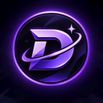

<div align="center">



# DimensiUI

**A modular, midnight-themed UI library for Roblox, with a one-file standalone build.**

[](CHANGELOG.md)
[](LICENSE)
[](https://create.roblox.com/docs)
[](dist/main.lua)

English · [Bahasa Indonesia](README.id.md)

</div>

| Release metadata | Value |
|---|---|
| Project | DimensiUI |
| Version | `1.0.1` |
| Release type | Stable |
| Author | telatnakal |
| Visual preset | Midnight (navy surfaces, violet accent) |
| Runtime | Roblox Luau |

**Version:** 1.0.1

---

## Contents

- [Highlights](#highlights)
- [Quick start](#quick-start)
- [Window options](#window-options)
- [Components](#components)
- [Minimize bubble](#minimize-bubble)
- [Notifications and dialogs](#notifications-and-dialogs)
- [Addons](#addons)
- [Multiple library instances](#multiple-library-instances)
- [Theme and typography](#theme-and-typography)
- [Project structure](#project-structure)
- [Development](#development)
- [License and provenance](#license-and-provenance)

## Highlights

- **Complete control set:** windows, tabs, sections, buttons, toggles, sliders, dropdowns, inputs, keybinds, color pickers and paragraphs.
- **Notifications and dialogs**, including action buttons on notifications.
- **Midnight visual system:** navy surfaces with a selective violet accent, plus runtime accent customization.
- **Responsive layout:** viewport-aware window sizing, a collapsible sidebar and adaptive control alignment.
- **Minimize bubble:** the window collapses into a round DimensiUI logo docked near the left edge, 75% down from the top of the screen, that restores the window when clicked.
- **Clean lifecycle:** independent library instances (`NewInstance()`), instance-owned cleanup callbacks (`AddCleanup()`) and an internal motion package (`DimensiMotion`).
- **Addons:** `SaveManager` and `InterfaceManager`, both with per-instance factories.
- **Two ways to ship:** a modular source tree (`src/`) and a generated standalone bundle (`dist/main.lua`).

## Quick start

Load the standalone bundle in an environment that allows `loadstring` and HTTP requests:

```lua
local DimensiUI = loadstring(game:HttpGet(
    "https://raw.githubusercontent.com/telatnakal/DimensiUI/main/dist/main.lua"
))()

local Window = DimensiUI:CreateWindow({
    Title = "DimensiUI",
    SubTitle = "v" .. DimensiUI.Version,
    TabWidth = 160,
    Size = UDim2.fromOffset(580, 420),
    Theme = "Dimensi", -- Midnight preset (kept as "Dimensi" for backwards compatibility)
})

local Tab = Window:AddTab({ Title = "Main", Icon = "home", Description = "Overview and quick actions" })
local Section = Tab:AddSection("Controls")

Section:AddButton({
    Title = "Example",
    Description = "Runs a callback",
    Callback = function()
        print("Clicked")
    end,
})

local Toggle = Section:AddToggle("AutoFeature", { Title = "Auto feature", Default = false })
Toggle:OnChanged(function()
    print("AutoFeature:", DimensiUI.Options.AutoFeature.Value)
end)

Window:SelectTab(1)
```

A complete, runnable example (tabs, dialog, slider, dropdown, addons) is in [`Example.lua`](Example.lua).

**Modular source:** use `default.project.json` with Rojo, or place the `src/` hierarchy in Roblox Studio as a ModuleScript tree and require the root module (`src/init.lua`).

## Window options

`DimensiUI:CreateWindow(config)` accepts:

| Option | Type | Default | Description |
|---|---|---|---|
| `Title` | `string` | required | Window title shown in the sidebar header. |
| `SubTitle` | `string` | `""` | Secondary text under the title. |
| `TabWidth` | `number` | `170` | Sidebar width, between `100` and `400`. |
| `Size` | `UDim2` | `590 × 470` offset | Initial size, clamped to the viewport. |
| `Theme` | `string` | `"Dimensi"` | Midnight preset. Only `"Dimensi"` is accepted. |
| `MinimizeKey` | `Enum.KeyCode` | `RightControl` | Hides or shows the whole interface. |
| `Icon` | `string \| number \| false` | built-in logo | Image used by the [minimize bubble](#minimize-bubble). |

Useful window methods: `AddTab`, `SelectTab`, `Dialog`, `Minimize`, `SetCollapsed`, `ToggleHidden`, `ToggleSidebar`, `SetSidebarCollapsed`, `SetIcon`, `Destroy`. Tabs accept an optional `Description` shown in the page header.

## Components

Add components to a tab or a section: `Tab:AddSection("Title")` returns a section with the same `Add*` methods.

| Component | Method | Main options | Object methods |
|---|---|---|---|
| Button | `AddButton(config)` | `Title`, `Description`, `Callback` | — |
| Toggle | `AddToggle(id, config)` | `Title`, `Description`, `Default`, `Callback` | `OnChanged`, `SetValue` |
| Slider | `AddSlider(id, config)` | `Title`, `Description`, `Default`, `Min`, `Max`, `Rounding`, `Callback` | `OnChanged`, `SetValue` |
| Dropdown | `AddDropdown(id, config)` | `Title`, `Description`, `Values`, `Default`, `Multi`, `AllowNull`, `Callback` | `OnChanged`, `SetValue`, `SetValues`, `Open`, `Close` |
| Input | `AddInput(id, config)` | `Title`, `Description`, `Default`, `Placeholder`, `Numeric`, `MaxLength`, `Finished`, `Callback` | `OnChanged`, `SetValue` |
| Keybind | `AddKeybind(id, config)` | `Title`, `Description`, `Default`, `Mode` (`Toggle`, `Hold`, `Always`), `Callback`, `ChangedCallback` | `OnClick`, `OnChanged`, `SetValue`, `GetState`, `DoClick` |
| Color picker | `AddColorpicker(id, config)` | `Title`, `Description`, `Default`, `Transparency`, `Callback` | `OnChanged`, `SetValue`, `SetValueRGB` |
| Paragraph | `AddParagraph(config)` | `Title`, `Content` | — |

Components created with an `id` are stored in `DimensiUI.Options[id]`, which is what `SaveManager` persists.

## Minimize bubble

The title-bar minimize button collapses the window into a small round DimensiUI logo.

| Behavior | Details |
|---|---|
| Position | Docked at the **left edge** (36 px gap), with its center at **75% of the screen height** (from the top). Every minimize re-docks it there, at any resolution. |
| Visibility | Always drawn above the rest of the interface (`ZIndex = 100`) and kept on-screen when the viewport changes. |
| Restore | Click or tap the bubble to bring the window back where it was. |
| Move | Drag the bubble to reposition it; it stays within the screen. |
| Animation | Slides in with a soft pop, grows slightly on hover, presses in on click and fades out when the window is restored. |
| Hide key | `RightControl` (configurable with `MinimizeKey`, or the Hide Bind in InterfaceManager) hides the window *and* the bubble; press it again to show whatever was visible. |

```lua
local Window = DimensiUI:CreateWindow({
    Title = "DimensiUI",
    MinimizeKey = Enum.KeyCode.RightControl,
    Icon = "rbxassetid://123456789", -- optional
})

Window:Minimize()         -- toggle minimize
Window:SetCollapsed(true) -- explicit minimize / restore
Window:ToggleHidden()     -- same as pressing the hide key
print(Window.Minimized, Window.IconStatus)
```

`Icon` is optional:

- **Empty:** the built-in DimensiUI logo, a small PNG embedded in the library and written once to the executor workspace folder `DimensiUI/`. This needs `writefile` and `getcustomasset`, and makes no network request.
- **`false`:** a plain "D" letter.
- **Custom image:** a Roblox asset id (`"rbxassetid://ID"` or a number), a file path in the executor workspace, or an image URL. A URL is downloaded once into `DimensiUI/` and reused afterwards (the only network request the library can make). A `github.com/.../blob/...` page link is converted to its raw link.

If a custom icon cannot be loaded, a notification explains why and the built-in logo is used. If the executor cannot load images at all, the bubble falls back to the "D" letter so it is never empty. `Window.IconStatus` describes what the bubble is currently showing.

## Notifications and dialogs

```lua
DimensiUI:Notify({
    Title = "DimensiUI",
    Content = "Configuration saved.",
    SubContent = "autoload.json",
    Duration = 4,
    Buttons = {
        { Title = "Undo", Callback = function() print("Undo") end },
    },
})

Window:Dialog({
    Title = "Confirm",
    Content = "Run this action?",
    Buttons = {
        { Title = "Yes", Callback = function() print("Confirmed") end },
        { Title = "Cancel" },
    },
})
```

Callbacks run through `Library:SafeCallback`, so an error in your callback shows a notification instead of breaking the interface.

## Addons

`SaveManager` and `InterfaceManager` keep their legacy singleton exports and also expose instance factories. Bind each addon instance to the matching library instance:

```lua
local SaveManager = loadstring(game:HttpGet("YOUR_SAVEMANAGER_RAW_URL"))()
local InterfaceManager = loadstring(game:HttpGet("YOUR_INTERFACEMANAGER_RAW_URL"))()

SaveManager:SetLibrary(DimensiUI)
InterfaceManager:SetLibrary(DimensiUI)
SaveManager:IgnoreThemeSettings()
SaveManager:SetIgnoreIndexes({ "MenuKeybind" })
SaveManager:SetFolder("DimensiUISettings/MyGame")
InterfaceManager:SetFolder("DimensiUISettings")

InterfaceManager:BuildInterfaceSection(Tabs.Settings)
SaveManager:BuildConfigSection(Tabs.Settings)
SaveManager:LoadAutoloadConfig()
```

Use a distinct folder for each manager when configurations must be stored separately. Addon instance isolation does not automatically create separate filesystem namespaces.

## Multiple library instances

Create a separate library instance when you need an independent UI lifecycle:

```lua
local PrimaryUI = DimensiUI
local SecondaryUI = DimensiUI:NewInstance() -- CreateInstance() is an alias

PrimaryUI:CreateWindow({ Title = "Primary" })
SecondaryUI:CreateWindow({ Title = "Secondary" })

SecondaryUI:Destroy() -- PrimaryUI remains alive
```

Each instance is intended to own its module tree and cache, GUI, theme registry, tab state, notifications, motion resources and cleanup lifecycle. Register extra teardown work with `AddCleanup`; callbacks run in reverse registration order when the instance is destroyed:

```lua
DimensiUI:AddCleanup(function()
    -- Release resources owned by this library instance.
end)
```

Verify runtime behavior in your target Roblox environment.

## Theme and typography

The visual preset is **Midnight**, registered internally as `Dimensi` for backwards compatibility. It uses deep navy surfaces and a selective violet accent, with solid surfaces and optional window transparency (no blur).

```lua
DimensiUI:SetAccent(Color3.fromRGB(255, 120, 90)) -- runtime accent
DimensiUI:ResetAccent()
DimensiUI:ToggleTransparency(true)
```

The sidebar collapses with the header menu control or `Window:ToggleSidebar()`. The typography resolver tries Builder Sans and falls back to supported Roblox font families; availability depends on the Roblox runtime.

## Project structure

```text
DimensiUI/
├── Addons/                  # SaveManager and InterfaceManager
├── Assets/                  # Logo sources (d-icon-128.png, d-icon-bubble.png)
├── dist/
│   └── main.lua             # Generated standalone bundle (do not edit by hand)
├── scripts/
│   ├── audit_static.py      # Static checks: parity, versions, contracts
│   ├── build_bundle.py      # src/ -> dist/main.lua
│   └── build_icon.py        # Assets/d-icon-bubble.png -> src/BubbleIcon.lua
├── src/                     # Authoritative modular source
│   ├── Components/          # Window, TitleBar, Tab, Section, Dialog, Notification, ...
│   ├── Elements/            # Button, Toggle, Slider, Dropdown, Input, Keybind, Colorpicker, Paragraph
│   ├── Packages/DimensiMotion/  # Internal motion / spring package
│   ├── Themes/              # Midnight ("Dimensi") theme
│   ├── BubbleIcon.lua       # Embedded logo (generated by build_icon.py)
│   ├── Creator.lua          # Instance factory, theme registry, signal tracking
│   ├── Icons.lua            # Icon map
│   └── init.lua             # Library entry point (Version lives here)
├── CHANGELOG.md
├── Example.lua              # Usage example
├── LICENSE                  # MIT
├── PROVENANCE.md
└── default.project.json     # Rojo mapping
```

## Development

`src/` is the source of truth. After editing it, regenerate the bundle and run the audit:

```bash
python3 scripts/build_bundle.py    # src/ -> dist/main.lua
python3 scripts/audit_static.py    # parity, version consistency, bubble contract
```

If you replace the logo, regenerate the embedded copy first:

```bash
python3 scripts/build_icon.py          # Assets/d-icon-bubble.png -> src/BubbleIcon.lua
python3 scripts/build_icon.py --check  # verify they match
```

To release a new version, update `Version` in `src/init.lua`, the version fields in both READMEs and the top entry of `CHANGELOG.md`, then rebuild. The audit fails if any of them disagree.

## License and provenance

DimensiUI is released under the [MIT License](LICENSE). The provenance of every pre-existing UI module and Roblox asset ID has not been independently established; review [PROVENANCE.md](PROVENANCE.md) and applicable upstream notices before redistributing third-party materials.

## Links

- Repository: <https://github.com/telatnakal/DimensiUI>
- Standalone bundle: <https://raw.githubusercontent.com/telatnakal/DimensiUI/main/dist/main.lua>
- Changelog: [CHANGELOG.md](CHANGELOG.md)
